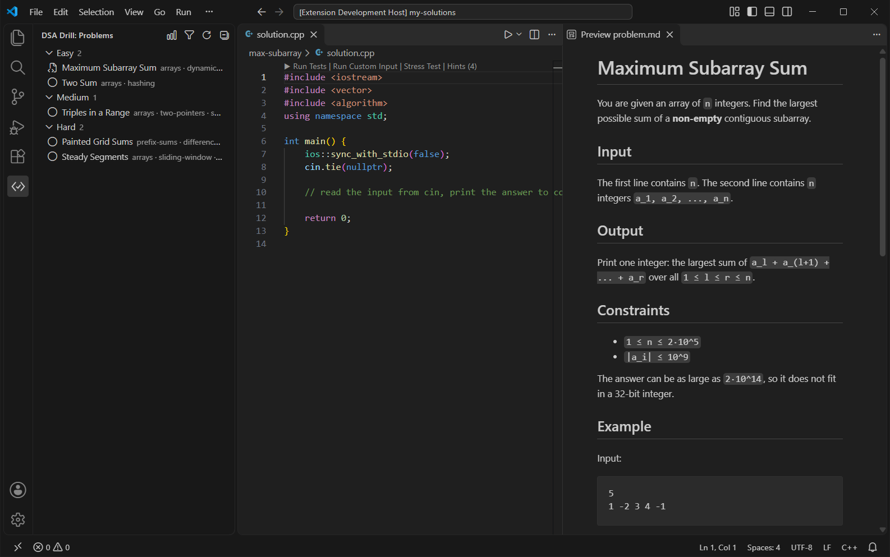
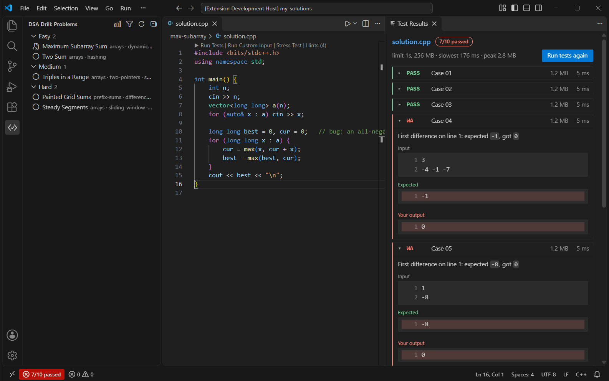
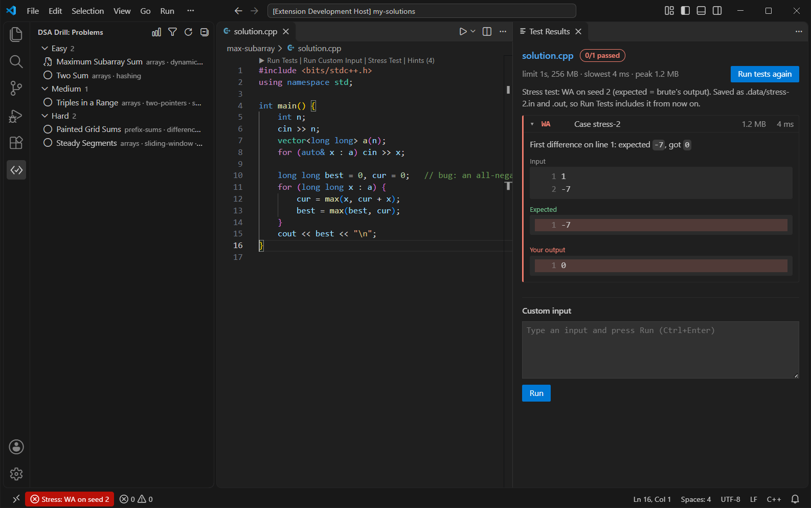
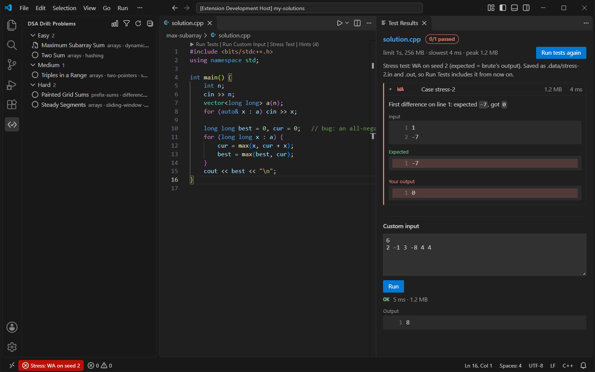
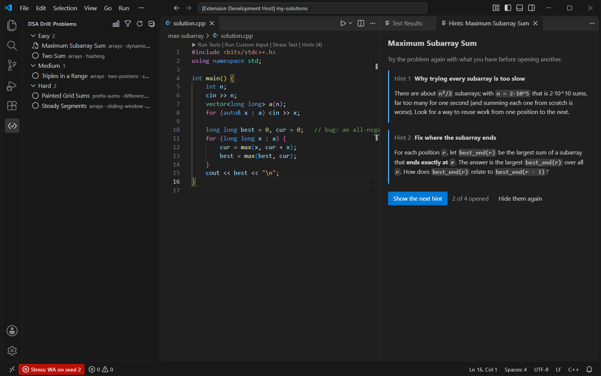
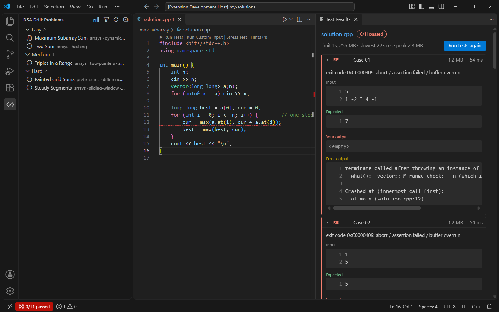
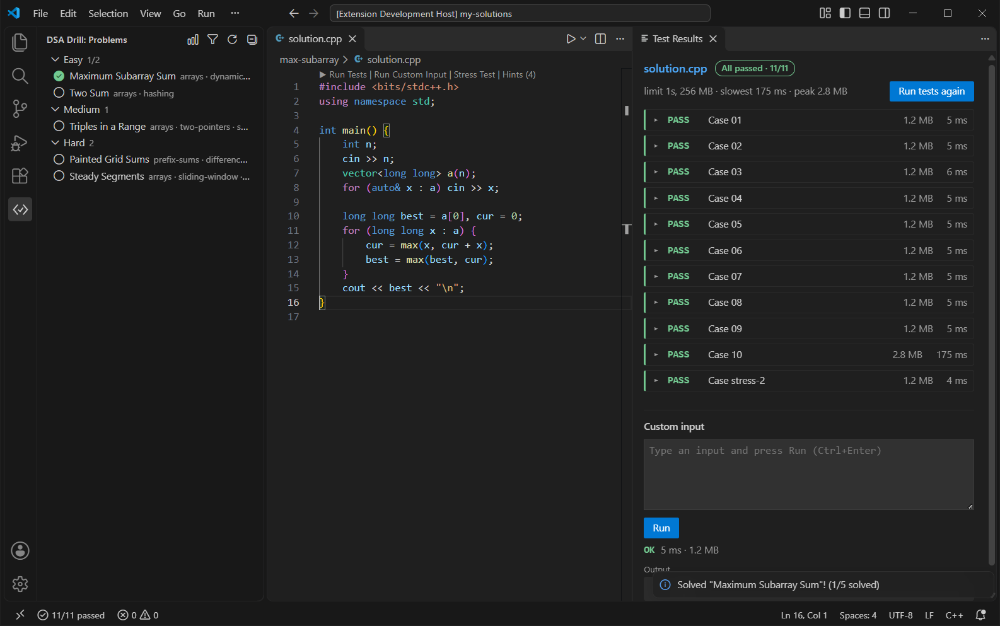
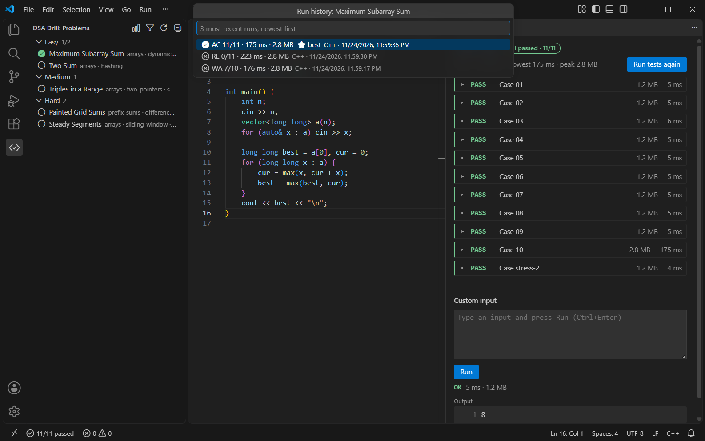
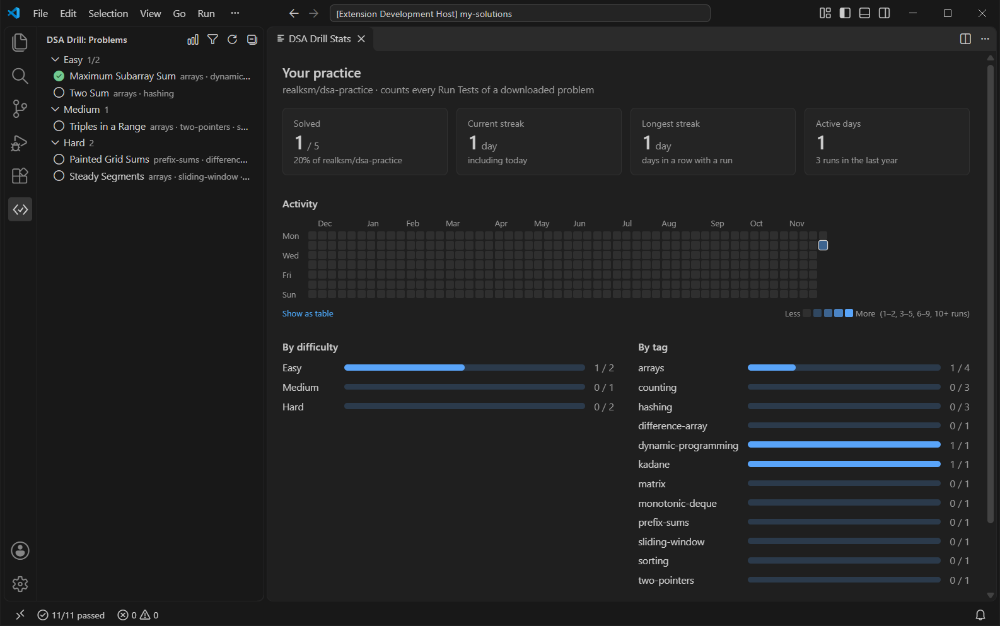

# DSA Drill

Practice data structures and algorithms problems inside VS Code. Open a problem from the
sidebar, write a solution in C++, Java or Python, and run its tests with one click.

This repo holds the extension (`extension/`) and the problems it shows (`problems/`).

## Using it

1. Install the extension (a `.vsix` file for now: **Extensions → ⋯ → Install from VSIX…**).
2. You need a compiler for your language on the PATH: `g++`, a JDK (`javac` + `java`), or Python 3.
   Each can also be set in the settings (`dsaDrill.compilers.*`).
3. Open a folder, then the **DSA Drill** panel in the activity bar. Click a problem and pick a language.
4. Write your solution and press **▶ Run Tests** above the code (or Ctrl+Alt+R).
   Each test shows PASS / WA / TLE / RE; a failing test shows its input, the expected output and yours.

Programs read standard input and print to standard output. Integers must match exactly;
decimals are accepted within 1e-6.

## Walkthrough

A tour of what DSA Drill does, from opening a problem to the stats page.
These screenshots are taken by a script (`npm run screenshots` in `extension/`).

### 1. Pick a problem

The **DSA Drill** panel in the activity bar lists the problems by difficulty, with their tags.
Click one and pick a language. The statement opens on the right and a starter file on the left.
Above the code are the links you'll use most: **▶ Run Tests**, **Run Custom Input**,
**Stress Test** and **Hints**.



### 2. Run the tests

Press **▶ Run Tests** (or Ctrl+Alt+R, Cmd+Alt+R on a Mac). Every test gets a verdict
(PASS, WA, TLE, MLE or RE) with its time and memory. A failing test opens to show its input,
the expected output, your output and the first line where they differ. Here the solution prints
`0` for an array where every number is negative.



### 3. Find a failing input with Stress Test

When the given tests pass but you're not sure, put a random input generator (`gen.py`) and a
slow but simple `brute.py` next to your solution. **Stress Test** runs both on up to 200 random
inputs and stops at the first one where your answer differs. That input is saved as a new test,
so Run Tests checks it from then on.



### 4. Try your own input

**Run Custom Input** runs your program on any input you type in the panel, without comparing it
to anything. Use it to try an edge case or print debug output (stderr is shown separately).



### 5. Stuck? Open a hint

Problems with hints get a **Hints** link. Hints open one at a time, from a nudge to the key idea,
and DSA Drill remembers how many you've opened.



### 6. See where it crashed

When a program crashes, the results show why, and for C++, Java and Python the line it crashed on.
That line is also underlined in the editor and listed in the Problems panel. Compile errors show
up the same way.



### 7. All tests pass

When every test passes, the problem gets a check mark in the sidebar and counts toward your
solved total.



### 8. Look back at your runs

Right-click a problem → **Show Run History** lists your recent runs with verdict, slowest test,
memory and language. Your best run is starred.



### 9. Track your progress

The graph button at the top of the sidebar opens your stats: problems solved, your daily streak,
a year of activity, and progress per difficulty and per tag.



## Problem format

```
problems/<slug>/
  problem.md          statement
  meta.json           { "title", "difficulty": "easy|medium|hard", "tags", "timeLimit" (seconds),
                        "memoryLimit" (MB) }
  .data/01.in 01.out  tests; every .out is generated from a reference solution
  .data/checker.cpp   optional: for problems with several right answers (see below)
  hints.md            optional: hints, one "## " heading each, shown one at a time
  starters/           optional: solution.cpp, Main.java, solution.py
index.json            generated list of all problems, read by the extension
```

## Adding problems (maintainer)

Reference solutions live in `references/<slug>/`, which is gitignored and never committed.
Commands run from the repo root after `npm ci` in `extension/`:

```
npm run new <slug>            create problems/<slug>/ and references/<slug>/ref.cpp
npm run new <slug> -- --checker --hints
                              ... with a checker and a hints.md to fill in
npm run build                 run each reference on every .in, write the .out files,
                              check the time limit, validate, rebuild index.json
npm run build -- <slug>       only that problem
npm run build -- --stress     also compare ref with references/<slug>/naive.* on
                              200 random inputs from gen.* (seed = argv[1])
npm run check                 what CI runs: every problem is valid and index.json is current
```

A **checker** (`.data/checker.cpp`, or `checker.py`) is run as `checker <input> <output> <answer>`,
where the answer is the reference's `.out`. It exits 0 to accept and 1 to reject, printing why;
any other exit means the checker is broken. `npm run build` checks that it accepts the reference's
own outputs, and `--stress` compares naive with ref through it.

**Hints** (`hints.md`) are fetched only when someone asks for them: they aren't downloaded with the
problem, and editing them doesn't mark the tests as changed.

Then commit and push. The extension shows new problems on its next refresh (raw GitHub files
can take about 5 minutes to update).
