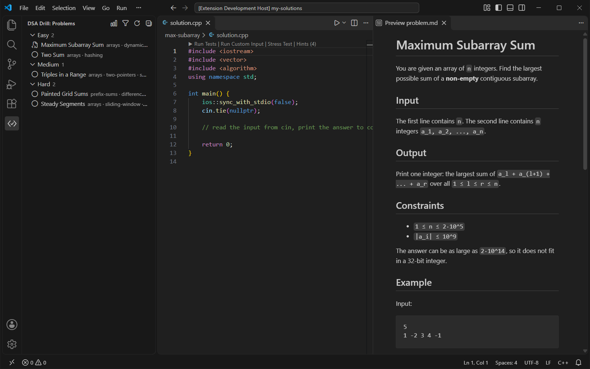
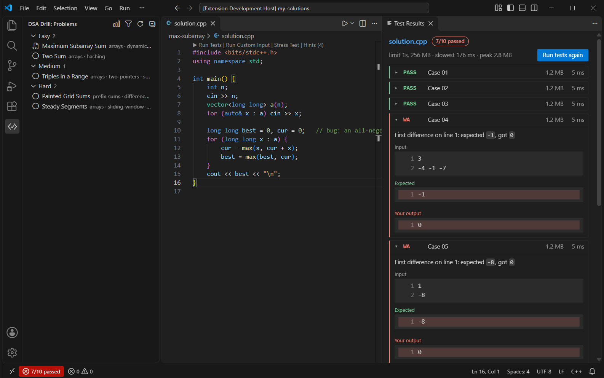
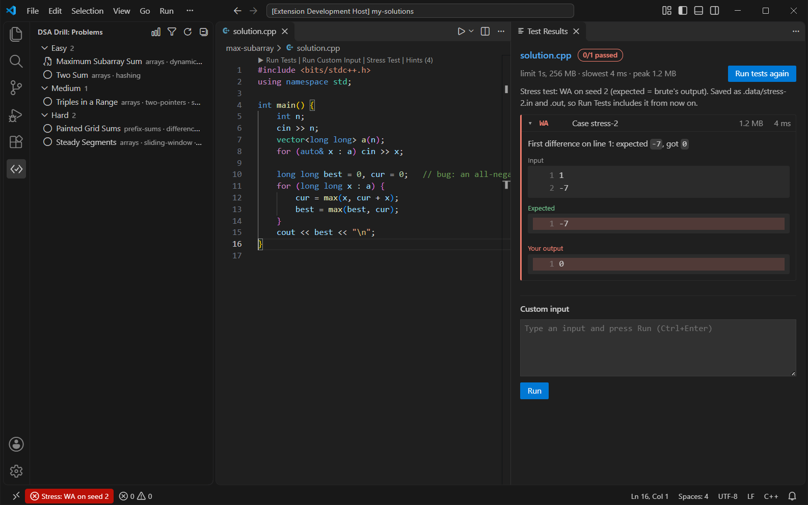
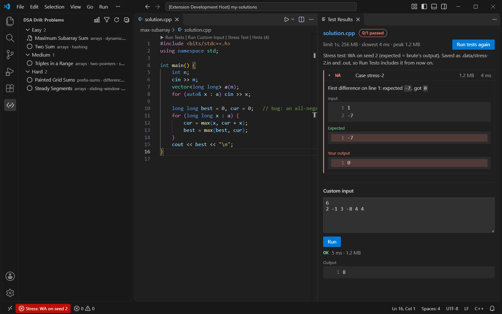
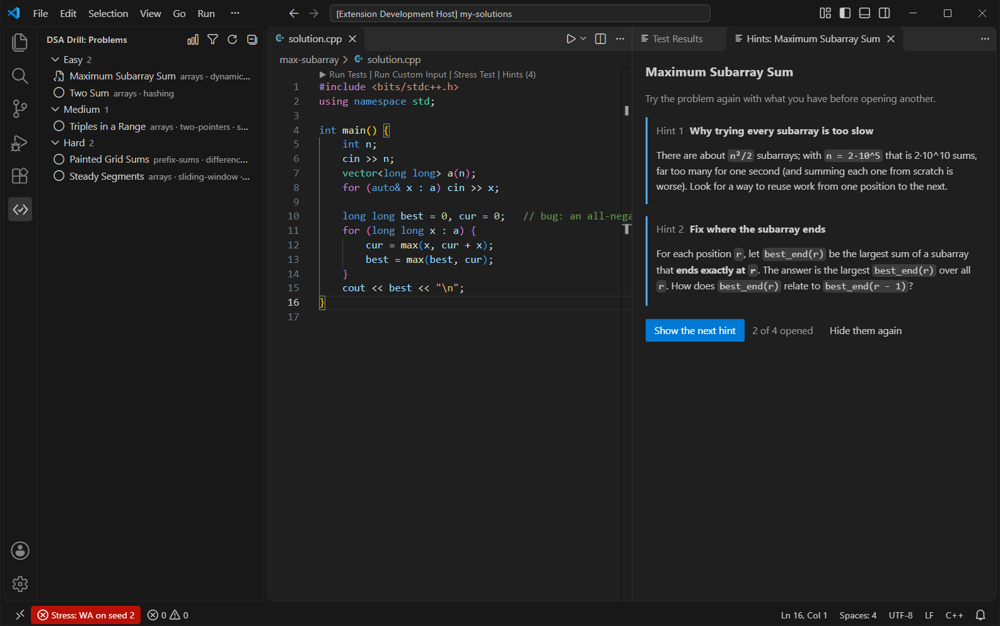
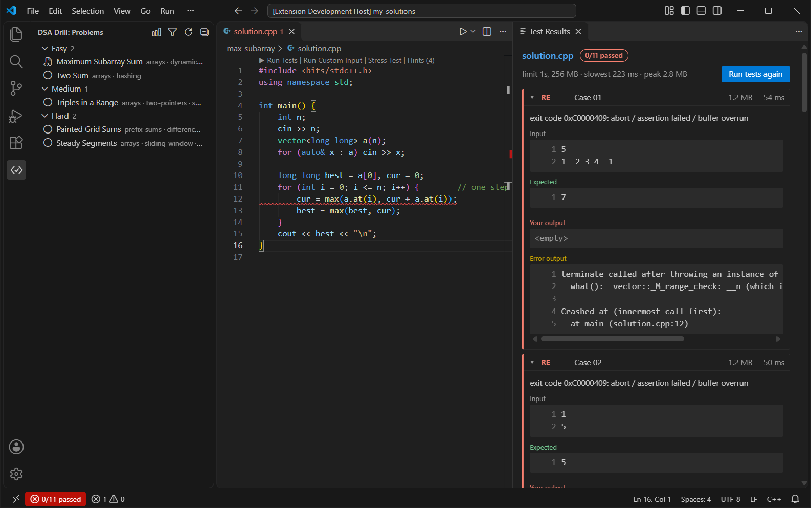
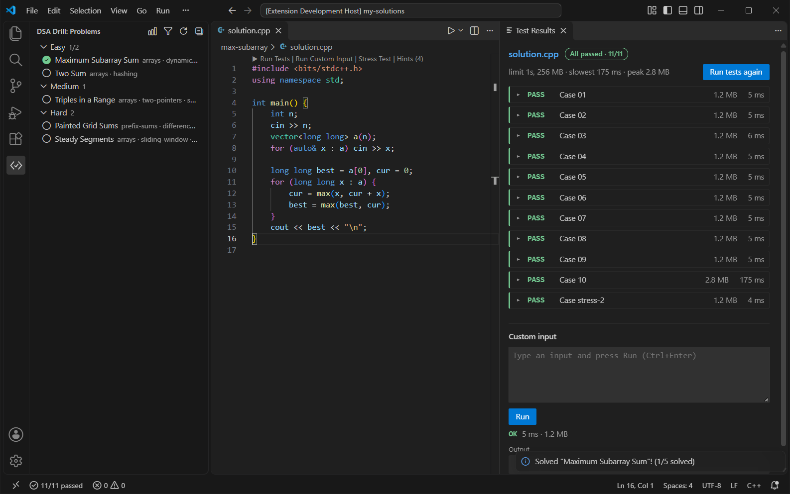
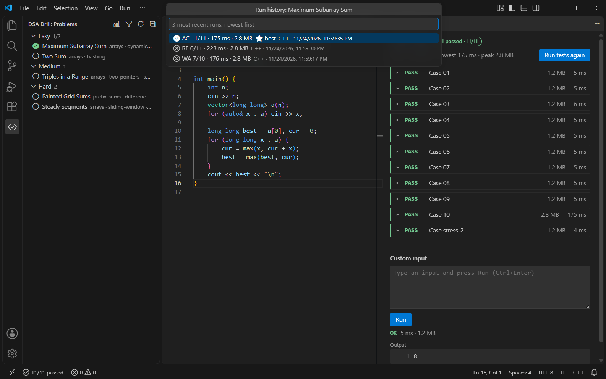
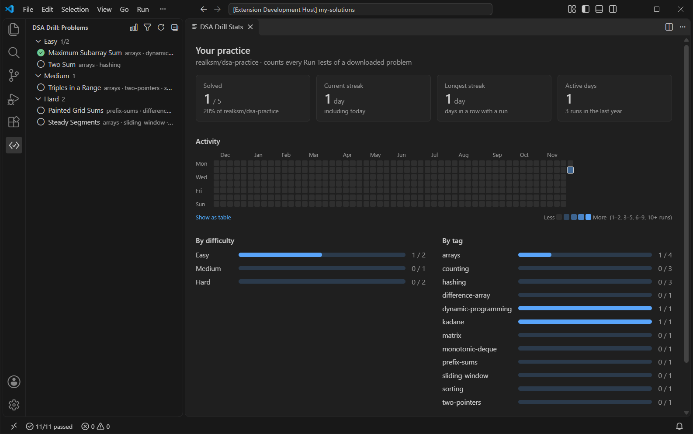

# DSA Drill

Practice data structures and algorithms problems inside VS Code. Pick a problem from the sidebar,
solve it in C++, Java or Python, and run its tests with one click.

## Getting started

1. Have a compiler for your language on the PATH: `g++`, a JDK (`javac` and `java`), or Python 3.
   You can also set full paths in the settings (`dsaDrill.compilers.*`).
2. Open a folder for your solutions, then open the **DSA Drill** panel in the activity bar.
3. Click a problem and pick a language. The statement opens beside a starter solution file.
4. Press **▶ Run Tests** above the code (or Ctrl+Alt+R / Cmd+Alt+R).

Programs read standard input and print to standard output, as on Codeforces or AtCoder.

## Walkthrough

A tour of what DSA Drill does, from opening a problem to the stats page.

### 1. Pick a problem

The **DSA Drill** panel in the activity bar lists the problems by difficulty, with their tags.
Click one and pick a language. The statement opens on the right and a starter file on the left.
Above the code are the links you'll use most: **▶ Run Tests**, **Run Custom Input**,
**Stress Test** and **Hints**.

### 2. Run the tests

Press **▶ Run Tests** (or Ctrl+Alt+R, Cmd+Alt+R on a Mac). Every test gets a verdict
(PASS, WA, TLE, MLE or RE) with its time and memory. A failing test opens to show its input,
the expected output, your output and the first line where they differ. Here the solution prints
`0` for an array where every number is negative.

### 3. Find a failing input with Stress Test

When the given tests pass but you're not sure, put a random input generator (`gen.py`) and a
slow but simple `brute.py` next to your solution. **Stress Test** runs both on up to 200 random
inputs and stops at the first one where your answer differs. That input is saved as a new test,
so Run Tests checks it from then on.

### 4. Try your own input

**Run Custom Input** runs your program on any input you type in the panel, without comparing it
to anything. Use it to try an edge case or print debug output (stderr is shown separately).

### 5. Stuck? Open a hint

Problems with hints get a **Hints** link. Hints open one at a time, from a nudge to the key idea,
and DSA Drill remembers how many you've opened.

### 6. See where it crashed

When a program crashes, the results show why, and for C++, Java and Python the line it crashed on.
That line is also underlined in the editor and listed in the Problems panel. Compile errors show
up the same way.

### 7. All tests pass

When every test passes, the problem gets a check mark in the sidebar and counts toward your
solved total.

### 8. Look back at your runs

Right-click a problem → **Show Run History** lists your recent runs with verdict, slowest test,
memory and language. Your best run is starred.

### 9. Track your progress

The graph button at the top of the sidebar opens your stats: problems solved, your daily streak,
a year of activity, and progress per difficulty and per tag.

## Features

- **Results panel:** PASS / WA / TLE / MLE / RE for every test, with time and peak memory. A failing
  test shows its input, the expected output, your output and the first line that differs.
- **Hints:** problems with hints get a **Hints** link above the code (and right-click → **Show Hints**
  in the sidebar). They open one at a time, from a nudge to the key idea, and the panel remembers how
  far you got.
- **Stats:** the graph button in the sidebar's title shows problems solved per difficulty and tag,
  your daily streak and a year of activity.
- **Run Custom Input:** run your program on input you type, without comparing.
- **Compile errors and warnings** go to the Problems panel, on the right line. When a C++, Java or
  Python solution crashes, the line it crashed on is marked too.
- **Stress Test:** put a generator (`gen.py`, prints a random input for the seed in `argv[1]`) and a
  slow but surely correct `brute.*` next to your solution; Stress Test runs both on seeds 1..200 and
  stops at the first input where your solution disagrees, crashes or is too slow. That input is saved
  as `.data/stress-<seed>.in` / `.out`, so Run Tests checks it from then on. It offers to create both
  helper files from templates.
- **Run history:** every Run Tests of a downloaded problem is kept (verdict, slowest case, language).
  The sidebar shows your best time; right-click → **Show Run History** lists recent runs.
- **Fast reruns:** a file is compiled once until you change it, across Run Tests, Custom Input and Stress Test.
- **Solved tracking:** a problem is marked ✓ once every test passes. Counts show in the sidebar,
  and your solved list follows you through Settings Sync. Right-click → **Mark as Unsolved** to reset one.
- **Filter:** the filter button in the sidebar narrows the list by tag or hides solved problems.
- **Test updates:** when a problem's tests change, the sidebar marks it, and **Update Tests** fetches
  the new ones without touching your solution. Test files you added to `.data/` yourself are kept.

## Judging rules

- Output is compared token by token. Integers must match exactly; decimals are accepted within 1e-6.
- Each problem has a time limit per test (in its `meta.json`), set for C++. Java gets twice that by
  default (JVM startup); Python gets the same. A problem can change this with `timeMultipliers` in its
  `meta.json`, and you can with the `dsaDrill.timeMultipliers` setting.
- A problem's `meta.json` can set a memory limit (`memoryLimit`, in MB). Going over it is **MLE**.
  C++ and Python count the whole program; Java counts its heap (`-Xmx`). Memory is measured by a
  small helper that DSA Drill builds once with `g++`; without `g++` it isn't measured and the panel
  says the limit wasn't checked.
- Problems where several answers are right come with a **checker** that decides; the panel then
  shows the reference answer as "One right answer" and the checker's reason when it rejects yours.
- C++ is compiled with `-std=c++17 -O2`, with a 256 MB stack and static linking on Windows.

## Settings

| Setting | What it does |
|---|---|
| `dsaDrill.repo` | Where problems come from: a public GitHub repo (`owner/repo`) or a local folder with a `problems/` folder. |
| `dsaDrill.workspaceFolder` | Folder that opened problems are downloaded into. Empty = the first workspace folder. |
| `dsaDrill.defaultLanguage` | Language for newly opened problems. Empty = ask each time. |
| `dsaDrill.compilers.cpp` / `javac` / `java` / `python` | Compiler or interpreter command or full path. |
| `dsaDrill.codeLens` | Show the Run Tests links above solution files. |
| `dsaDrill.customInputTimeLimit` | Seconds a Run Custom Input run may take. |
| `dsaDrill.timeMultipliers` | Time limit factor per language, e.g. `{ "python": 3 }`. |
| `dsaDrill.stressRuns` | How many random inputs Stress Test tries (default 200). |

Problems and source: [github.com/realksm/dsa-practice](https://github.com/realksm/dsa-practice).
